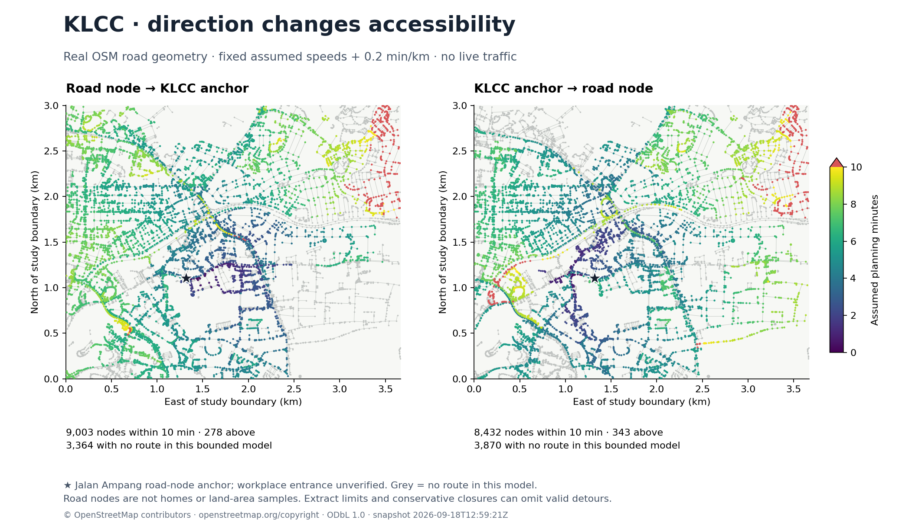
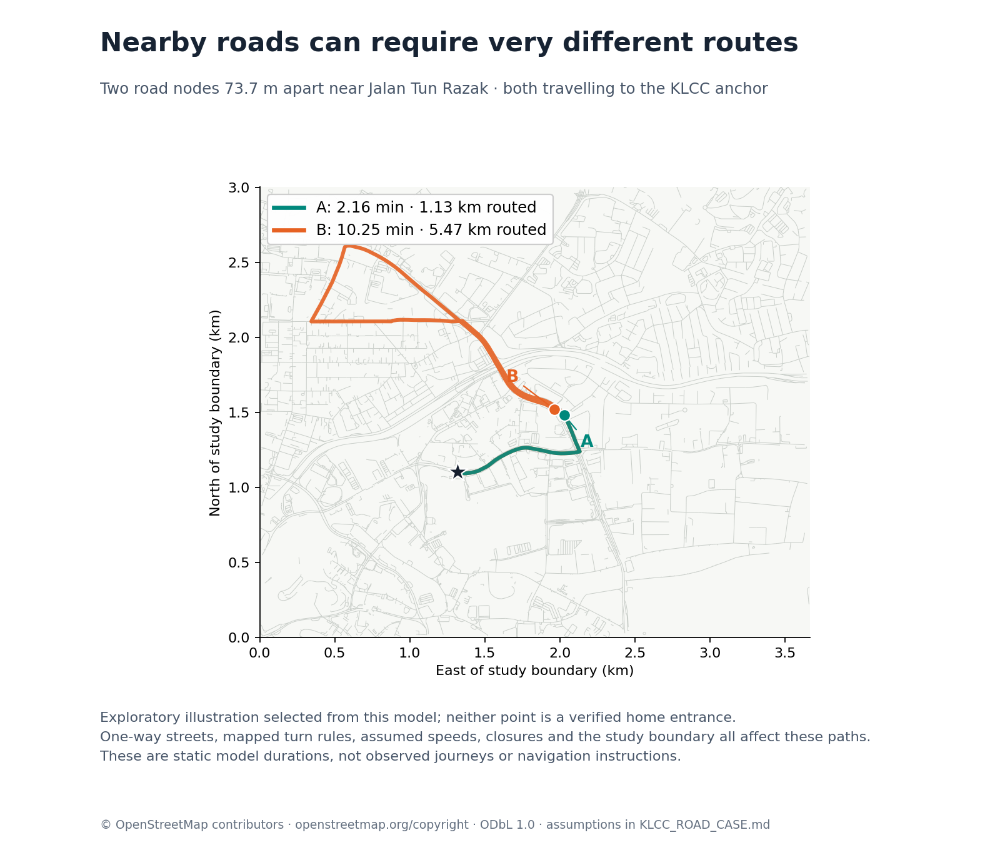

# KLCC: a bounded real-road algorithm case

Recorded 2026-09-18. **Real road geometry; assumed static travel times.**
This is a separate CLI experiment. The existing local browser demo remains synthetic.
No live traffic, commercial routing account, or paid API call is involved.

## What this adds

The project now routes over an attributed, frozen OpenStreetMap extract around
KLCC and Jalan Tun Razak, respecting supported one-way, access and turn rules.
It tests the motivating distinction between nearby locations with different road
access. It does not establish real journey times or complete the traffic-aware V1.



## Reproduce it

Python 3.10+, standard library only for routing, tests and JSON output:

```bash
python -m commute_map roads --output outputs/klcc-inbound.geojson
python -m commute_map roads --direction work_to_home --output outputs/klcc-outbound.geojson
python -m commute_map roads --probe 293569258 --output outputs/klcc-route-b.geojson
python -m scripts.evaluate_roads
python -m unittest discover -s tests -v
```

The optional figure command needs matplotlib in the selected Python environment:

```bash
python -m scripts.evaluate_roads --plots
```

The road command accepts `--threshold` (default 10 minutes), `--buffer` (default
0.2 min/km), `--direction`, and an optional retained OSM node ID as `--probe`.
GeoJSON contains one point per retained road node, null time for `no_route`, the
full import audit, attribution and assumptions. A requested route is an additional
top-level `route` Feature in driving order. It has null geometry for no route or
an anchor-to-itself journey. No residential polygons or grid interpolation are
inferred from these road nodes.

## Frozen source and domain

| Item | Value |
| --- | --- |
| Source | OpenStreetMap via the public Overpass API |
| OSM base timestamp | 2026-09-18T12:59:21Z, as reported by the response |
| Query bounds, south/west/north/east | 3.149, 101.701, 3.176, 101.734 |
| Approximate dimensions | 3.0 km north–south × 3.7 km east–west |
| Road-node anchor | OSM node 1198097247, longitude 101.712888, latitude 3.1589231 |
| Anchor meaning | A chosen Jalan Ampang road node near KLCC; workplace entrance unverified |
| Input | 23,928 nodes, 6,787 ways, 342 restriction relations |
| Retained graph | 12,645 nodes, 20,106 directed road segments |
| Compiled restriction relations | 291 |
| Relations requiring fallback | 51, removing 109 directed segments in total |
| Effective forbidden segment sequences | 285 after closures and reindexing |

The [data manifest](../../commute_map/data/klcc/manifest.json) includes SHA-256
checksums of the raw response and bundled normalized snapshot. The loader checks
the snapshot checksum before using it. The exact query and normalization script
are checked in. Fresh download is optional and produces a different, later source;
the bundled snapshot is what makes these results replayable.

Segments are retained only when both endpoint nodes are inside the box and usable.
The model cannot follow a detour outside it. This deliberately bounded algorithm
exercise differs from the original V1 rule that a commute may leave the candidate
study area. Counts and paths must not be treated as complete city accessibility.

## Time and access assumptions

For a route, minimize `sum(60 × segment_km / assumed_speed_kph + beta × segment_km)`.
Distances use haversine segment lengths with mean Earth radius 6371.0088 km.
Speeds below are experiment parameters, not observations, speed-limit claims or
a calibrated free-flow estimate. `maxspeed` tags are not used.

| Road class | Assumed km/h |
| --- | ---: |
| motorway | 60 |
| trunk | 50 |
| primary | 40 |
| secondary | 35 |
| tertiary, motorway_link | 30 |
| residential, unclassified, primary_link, trunk_link | 25 |
| secondary_link, tertiary_link | 20 |
| service | 15 |
| living_street | 10 |

All nodes are network probes. There is no imposed heading at their start or end,
no validated driveway, and no condo/workplace access allowance. Signals, queues,
turn delays, toll payments, surface quality and live conditions are unmodelled.
The original synthetic case still demonstrates the separate condo allowance.

The importer preserves OSM node identity; coordinate proximity and crossing lines
never create a junction. Explicit one-way direction and mode-specific overrides
are respected. Roundabouts and motorways imply one-way only when no override is
present; motorway links are not automatically assumed one-way. Car access takes
precedence in the order `motorcar`, `motor_vehicle`, `vehicle`, `access`.
Only unspecified class access or explicit `yes`, `permissive`, `designated` is
accepted. Destination-only, private, customer access and unknown values are omitted.
Conditional/directional access and conditional/unknown one-way rules are omitted.
Unverified barriers are excluded; a small set of gate types needs explicit access.
These are documented conservative choices within the broader
[OSM one-way](https://wiki.openstreetmap.org/wiki/Key:oneway) and
[access](https://wiki.openstreetmap.org/wiki/Key:access) schemas, not a complete
OSM driving profile.

## Turn restrictions and the algorithm

[OSM restrictions](https://wiki.openstreetmap.org/wiki/Relation:restriction) can
specify an incoming way, a via node or several via ways, and an outgoing way.
The importer compiles supported unambiguous relations into exact forbidden
directed-segment sequences. A `no_*` rule blocks the complete manoeuvre. An `only_*`
rule blocks deviations at every required prefix, including premature exits from
via ways. Car exceptions are respected. Same-way U-turn restrictions are distinguished
from straight continuation. Multiple constraints are enforced together, conservatively.

Missing members, unusable segments, ambiguous joins and unsupported rules close
the known incoming way. If a from-member is absent, known member ways are closed.
A fallback can remove zero segments when its approach is already absent. The 51
fallback reasons are: unavailable approach/exit 31; malformed members 10;
unsupported via members 4; missing member way 2; unavailable via segment 2;
ambiguous via connection 2. Every relation and closure is listed in the JSON audit.
In addition, immediate reversal over a road segment is prohibited everywhere as
a conservative modelling assumption. The model does not infer Malaysian U-turn law.

A node-only Dijkstra state cannot remember whether the approach makes the next
turn forbidden. `TurnRoutingIndex` therefore tracks the previous directed segment
and the longest route suffix that is a prefix of a forbidden sequence. Shorter
overlapping rules remain detectable as suffixes of that memory. Dijkstra runs on
these expanded states with nonnegative edge costs, taking the cheapest state at
each road node as its answer.

For inbound search, both road traversal and every forbidden sequence are reversed.
Reversing edges alone would enforce the wrong history. `only_*` rules have already
been expressed as forbidden deviations, so the same sequence reversal applies.
Reconstruction restores original driving order. With `S` reached states and `A`
considered transitions, heap search is approximately `O((S + A) log S)`, plus cached
restriction suffix checks of cost dependent on maximum restriction length. This
case reached 13,068 inbound states and 12,496 outbound states; it does not enumerate
every full journey history.

## Results and denominators

Default threshold 10 minutes; buffer 0.2 min/km. Every retained road node is queried.

| Direction | All road-node probes | Within limit | Above limit | No route in this model |
| --- | ---: | ---: | ---: | ---: |
| Node → KLCC anchor | 12,645 | 9,003 | 278 | 3,364 |
| KLCC anchor → node | 12,645 | 8,432 | 343 | 3,870 |

Node density reflects mapping detail. These are neither percentages of land nor
counts of homes. No-route combines disconnection, directed access, restrictions,
deliberate closures and extraction limits; it does not prove real inaccessibility.

For a sensitivity check, disable only the compiled turn sequences while holding
the retained graph, one-way streets, immediate-reversal ban, speeds and bounds
fixed. This is a model ablation, not an external accuracy benchmark.

| Effect of restoring compiled turn rules | Inbound | Outbound |
| --- | ---: | ---: |
| Routable nodes with increased model time | 4,283 | 4,551 |
| Nodes made unroutable in the bounded model | 191 | 156 |
| Nodes incorrectly inside the limit when rules are disabled | 202 | 180 |
| Largest increase among mutually routable nodes | 5.29 min | 7.44 min |

### A nearby-road illustration



| Probe | OSM node | Inbound model time | Routed distance |
| --- | ---: | ---: | ---: |
| A, near Jalan Aman / Jalan Tun Razak | 1198144301 | 2.16 min | 1.13 km |
| B, Jalan Tun Razak | 293569258 | 10.25 min | 5.47 km |

The nodes are 73.7 m apart. This pair was selected exploratorily for the largest
inbound gap among nodes incident to a non-motorway/trunk road, routable in both
directions and separated by 20–80 m. It is not a held-out test or a claim about
real homes. The displayed difference can reflect one-way geometry, mapped turn
rules, assumed speeds, conservative closures and the bounded graph. Its purpose
is to expose why straight-line proximity alone is inadequate in this model.
The full ordered nodes and way IDs are in [KLCC_RESULTS.json](KLCC_RESULTS.json).

## Verification and remaining work

The 24 new tests cover import direction/access, barriers and clipping, disconnected
coincident coordinates, via-node and via-way restrictions, only-turn deviations,
overlapping histories, incomplete-rule fallback, numeric validation and checksum
failure. On 24 seeded five-node graphs, every probe in both directions is compared
with an independent full-history state expansion plus Bellman–Ford: 240 comparisons,
including zero weights and variable distance buffers. A deterministic sample of
routes across the real extract is checked for continuity, cost and forbidden
subsequences. These validate implementation against its stated model, not the
accuracy of OSM tags or real driving permission.

Remaining: audit specific entrances and manoeuvres against a suitable trusted
source, expand routing coverage beyond the candidate domain, model missing access
semantics, validate actual journey times, and evaluate spatial sampling on verified
access points. The synthetic UI still needs real browser layout/download checks.
UNDERSTOOD remains unverified; the related [learning exercise](../learning/TURN_RESTRICTIONS.md)
does not claim the developer has completed it.

## Data attribution

© [OpenStreetMap contributors](https://www.openstreetmap.org/copyright), available
under [ODbL 1.0](https://opendatacommons.org/licenses/odbl/1-0/). Source data, derived
outputs and both figures retain this attribution. See the
[attribution guidance](https://osmfoundation.org/wiki/Licence/Attribution_Guidelines)
and [snapshot README](../../commute_map/data/klcc/README.md). The repository's
software licence and public release remain separate, uncompleted decisions.
