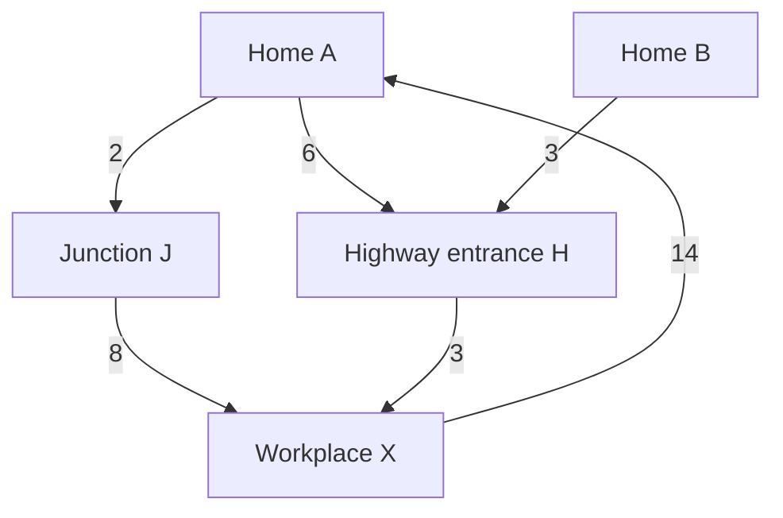

# Offline Algorithm Milestone

Original plan: 2026-09-17. Update: 2026-09-18. The offline MVP and measured comparison now exist; see [current state](../../PROJECT_STATE.md) and [MVP guide](../MVP_GUIDE.md). The user subsequently authorized autonomous implementation without waiting for lesson answers. This document preserves the original learning sequence; its pre-implementation gates are learning goals, not current build blockers. Understanding remains unverified.

## Purpose and scope

Research question:

> Can adaptive spatial sampling approximate a commute-time region with fewer travel-time queries than uniform sampling at comparable accuracy, including difficult access patterns?

The first deliverable is a reproducible algorithm experiment. The original traffic-aware V1 remains a later target in `PROJECT_BRIEF.md`. Commercial-provider research is paused with its unresolved questions preserved. Offline work needs no commercial credentials or provider results.

Use small synthetic networks first, followed later by a bounded real road-network case with explicitly stated static weights. Synthetic costs and static estimates are not observed congestion, realistic peak-hour predictions, or evidence of journey reliability. A static node-and-edge model also does not automatically encode turn restrictions, entrance access, traffic signals, or private-road permissions.

## Work sequence

| Step | Deliverable | Evidence before advancing |
| --- | --- | --- |
| O1 — Directed graph foundation | Hand-worked example, then a small fixed-weight travel-time component. | The developer explains legal directed paths, total route cost, and threshold membership; implementation agrees with hand-checked cases and an independent reference. |
| O2 — Spatial baseline | A reproducible spatial fixture and a uniform-sampling boundary estimate. | Coordinate units, admissible access locations, point-to-graph mapping, reference values, and missing-data handling are explicit; boundary and budget cases checked. |
| O3 — One adaptive method | A justified refinement policy with a finite query budget. | Compare candidate approaches and complete the learning check; compare against O2 using frozen evaluation points and shared boundary logic. |
| O4 — Evaluation and presentation | Query/error results, failure analysis, a small map, and reproduction instructions. | Report all scenarios, unresolved points, runtime, and query counts; explain when the method helps or fails. A bounded OSM case study follows only after the synthetic experiment works. |

Python is recommended for the first implementation. Prefer small functions and an existing reference library over a general plugin architecture. The developer should own and understand the sampling policy and core boundary method claimed as the contribution. Quadtree refinement, interpolation, and Marching Squares remain candidates until the baseline and its failure modes are understood.

The hand-worked graph below has no geographic coordinates. It teaches routing semantics; it is not yet a spatial sampling benchmark or an isochrone implementation.

## Minimum mathematical model

A directed weighted graph is `G = (V, E, w)`:

- `V`: access points and junctions.
- `E`: permitted directed connections. An edge `u -> v` does not imply `v -> u`.
- `w(u, v)`: fixed nonnegative travel time for that connection, in a stated unit.

For a legal path `P`, its cost is the sum of its edge weights. With workplace `X`:

$$
T_G(p,X)=\min_{P:p\leadsto X}\sum_{e\in P}w(e),
\qquad
S_Y=\{p\in A:T_G(p,X)\le Y\},
$$

where `A` is the designated set of candidate home access points. We only assign a finite duration when a directed path exists. In implementation, a proven no-route result stays separate from a failed or unmade query; neither receives a fabricated duration. Equality with the threshold is inside.

Manual enumeration is suitable for this small lesson. It grows impractical on large networks, so Dijkstra is the recommended fixed, nonnegative-weight reference approach for the next component. Before implementation, explain its tentative-distance/priority-queue idea and check the developer's reasoning. It is a standard routing algorithm, not this project's claimed new method.

With a complete fixed-weight graph, inbound distances to `X` can be computed by reversing every edge, retaining its weight, and running one single-source shortest-path calculation from `X`. Each original path to `X` corresponds to a reversed path of the same cost from `X`. This is a computational transformation, not permission to drive against the original arrows. It does not justify reversing a time-dependent API query.

## What sampling is optimizing

The offline reference model can compute all required answers directly. For the sampling experiment, expose only a function that returns the travel time for a requested access point. The sampler cannot inspect unqueried reference values or use held-out labels to select samples.

This restricted interface models a later setting where travel-time queries are expensive. Count distinct queried points and total query attempts separately; report cache hits explicitly. Count reference generation separately and report its cost. Reducing simulated query counts does not establish lower real API cost or faster end-to-end runtime than a single graph search.

Before O2, fix the spatial domain, metric coordinates, admissible access mask, and point-to-graph mapping. Apply the same mapping to both methods. Do not smooth across invalid access areas or silently snap opposite road sides to one location. Synthetic field fixtures may supplement graph cases, but easy smooth fields alone do not validate road-access behaviour.

## Evaluation design

- Compare error at equal query budgets and query counts at equal error targets.
- Use the same interpolation/boundary method when isolating the effect of sample selection.
- Freeze independent evaluation points and scenarios before tuning. Keep refinement development cases separate from final evaluation cases; later reference labels cannot guide sampling.
- Report classification agreement over all eligible evaluation points, false inclusion among reference-outside points, false exclusion among reference-inside points, and the unresolved fraction. Unresolved predictions do not count as agreements. Report reference no-route cases separately.
- Include below/equal/above-threshold values, directed asymmetry, unreachable locations, budget exhaustion, access discontinuities, narrow reachable pockets, holes, and domain-edge effects as the relevant components are added.
- All corner samples having one label does not prove that a cell has that label everywhere. An adaptive method can miss an isolated interior pocket. Report this failure; do not claim a general guarantee without assumptions and a proof.
- Report runtime, seeds/settings, reference construction, and all tested outcomes. Synthetic model agreement is distinct from agreement with provider ETAs or actual journeys.

The offline experiment settings are recorded in [the fixed plan](../evaluation/MVP_EXPERIMENT_PLAN.md), and outcomes in [the results](../evaluation/MVP_RESULTS.md). The original V1 criteria C1–C8 remain unchanged and unmeasured. Any résumé claim must identify the synthetic model and what was actually measured; no general adaptive-sampling improvement was demonstrated.

## First learning example

All times are invented, fixed, and in minutes. A and B are homes, J is a junction, H is a highway entrance, and X is the workplace. These are the only edges:

| From | To | Minutes |
| --- | --- | ---: |
| A | J | 2 |
| J | X | 8 |
| A | H | 6 |
| B | H | 3 |
| H | X | 3 |
| X | A | 14 |

For example, the route `A -> J -> X` costs `2 + 8 = 10` minutes. That is one route, not yet proof of the fastest route. Compare complete paths, not just the first road. The `X -> A` edge applies only in its shown direction. Since every edge here has positive cost, adding a cycle cannot improve a route.

**Active checkpoint:** With a maximum commute of 8 minutes from home to X, which of A and B qualify? Show the paths and totals you compare.

Do not record the answer or UNDERSTOOD = YES until the user supplies their reasoning. Follow up on the direction distinction if necessary, then introduce the next component. Earlier departure-time and reliability checkpoints are deferred to the live-provider work; they do not block this static lesson.

## References

Official documentation checked on 2026-09-17:

- [NetworkX single-source Dijkstra](https://networkx.org/documentation/stable/reference/algorithms/generated/networkx.algorithms.shortest_paths.weighted.single_source_dijkstra_path_length.html): fixed weighted shortest-path reference functionality.
- [NetworkX directed graph reversal](https://networkx.org/documentation/stable/reference/classes/generated/networkx.DiGraph.reverse.html): reverses edge directions.
- [OSMnx graph construction](https://osmnx.readthedocs.io/en/stable/user-reference.html#osmnx.graph.graph_from_place): a candidate for the later real road-network case study.
- [OSMnx edge travel times](https://osmnx.readthedocs.io/en/stable/user-reference.html#osmnx.routing.add_edge_travel_times): free-flow estimates based on lengths and speeds; no traffic validation is implied.
